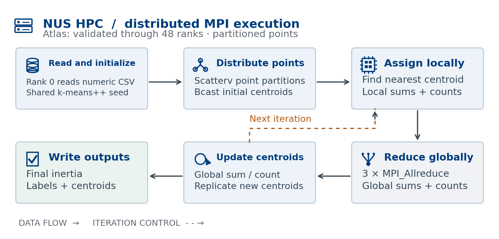
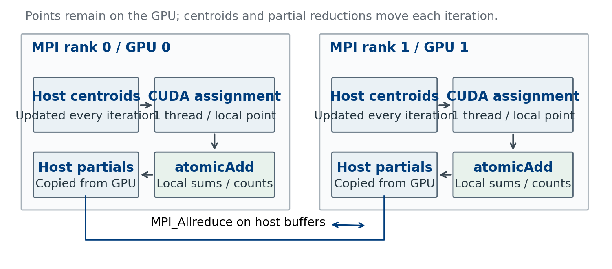
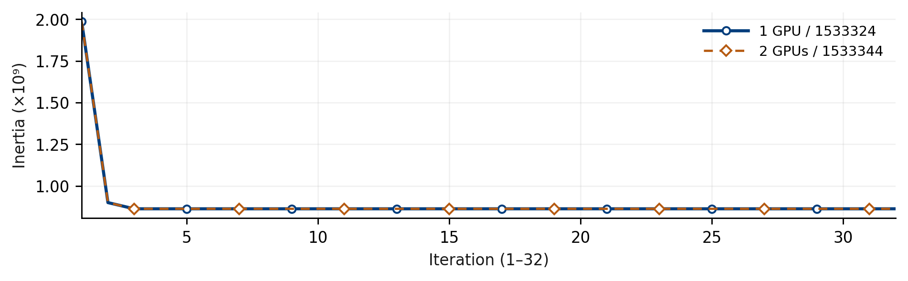
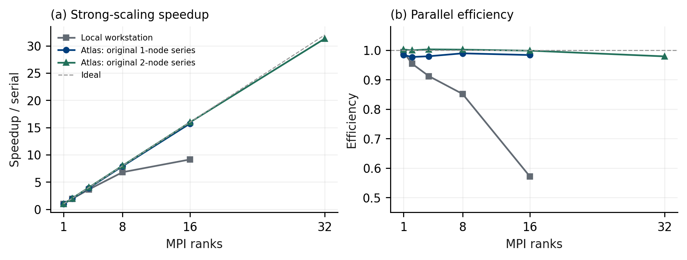
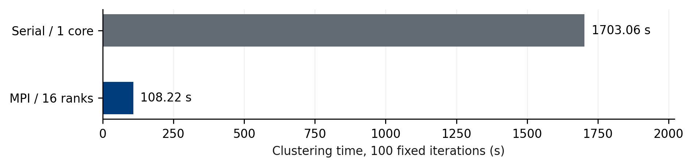
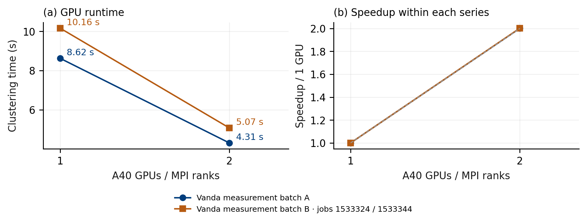

<!-- Generated from the completed-run publication report. -->

# Parallel K-means clustering with MPI and CUDA

Distributed centroid reduction and GPU acceleration on Atlas and Vanda


DSA5208 · Scalable Distributed Computing for Data Science

| AUTHOR | STUDENT ID |
| --- | --- |
| AMRIT SATPATHY | A0355181E |
| RITIK SRIVASTAVA | A0355860X |

National University of Singapore · November 2026

Source code and reproducible experiment records

github.com/AmritSatpathy/parallelKmean [github.com/AmritSatpathy/parallelKmean](https://github.com/AmritSatpathy/parallelKmean)

## Abstract

K-means combines independent nearest-centroid searches with a globally coupled centroid update, making it a useful case study in distributed and accelerator computing. We implement Lloyd’s algorithm in serial C++, CPU MPI, and MPI+CUDA, sharing the same data representation and k-means++ seeding. MPI partitions points across ranks and combines local centroid statistics through three Allreduce collectives per iteration. CUDA replaces each rank’s local assignment loop with one thread per point while keeping cross-rank reductions on host buffers. Experiments use MNIST for real-data interpretation and synthetic Gaussian blobs for strong scaling. The Atlas 100-iteration workload covers three million 64-dimensional points and 128 clusters at 12, 16, 24, 32, and 48 ranks across six completed jobs. At 48 ranks, clustering takes 36.422506 s versus a job-matched serial baseline of 1722.174826 s, giving 47.28× speedup and 98.51% efficiency. A complementary 32-iteration study reaches 31.32× at 32 ranks across two nodes. Vanda GPU batches A and B both approximately halve runtime from one to two A40s; batch B takes 10.159337 s and 5.073951 s respectively, giving 2.002× speedup. Matching displayed inertia supports numerical agreement within matched workloads. The report integrates completed team experiments and distinguishes iteration-loop timings from initialization and scheduler wall time, while retaining clear limits on numerical identity and run-to-run variability.

## 1. Introduction and objectives

The project investigates how decomposition and synchronization affect the parallel scaling of a nontrivial algorithm. Lloyd’s K-means alternates nearest-centroid assignment and centroid recomputation [1]. The assignment step is independent across points, but the update requires statistics from every partition. The complete algorithm therefore requires communication and coordinated iteration, satisfying the assignment’s requirement to go beyond an embarrassingly parallel workload.

Our objectives are to establish a serial correctness reference, explain the MPI design and its CUDA extension, measure strong scaling on Atlas and Vanda, and interpret clustering quality on MNIST. The implementation remains within the MPI+CUDA scope. Larger algorithms or additional programming frameworks are unnecessary to answer these questions.

The completed experimental program covers CPU scaling through 48 MPI ranks, two fixed-iteration workload budgets, and GPU scaling through two devices in two measurement batches. All runs contribute to the same team study. Workload and batch labels preserve valid baseline comparisons while the execution ledger links the completed experiments to their evidence.

## 2. Algorithm and datasets

### 2.1 Objective, initialization, and iteration

For n points xᵢ in d dimensions, K centroids μⱼ, and cluster assignment a(i), K-means minimizes the within-cluster sum of squared distances, or inertia. The squared distance avoids a square root without changing the nearest-centroid decision.

J = ∑i=1…n ‖xi − μa(i)‖2 (1)

All variants use k-means++ initialization [2], with a fixed seed for comparisons within a series. Each iteration assigns points to their nearest centroid, accumulates sums and counts, and replaces each nonempty centroid by the arithmetic mean of its assigned points. Empty clusters retain their previous centroid. Assignment costs O(nKd); centroid accumulation costs O(nd). K-means++ seeding costs O(nKd) overall and is performed once outside the timed clustering loop.

The default convergence path tests relative inertia change; the CPU implementations also test whether assignments stopped moving. Benchmark runs instead pass --fixed-iter so that all configurations execute the same number of iterations. The log phrase “converged in” is therefore interpreted as “completed” for these fixed-iteration measurements, without claiming that a convergence criterion was met.

### 2.2 Dataset definitions and comparability

Table 1. Data used for quality analysis and performance experiments.

| Dataset / experiment | Points | Features | K | Iterations |
| --- | --- | --- | --- | --- |
| MNIST, clustering quality | 70,000 | 784 | 10 | Convergence |
| Synthetic, CPU scaling / GPU batch A | 3,000,000 | 64 | 128 | 32 fixed |
| Synthetic, Atlas 12–48 ranks | 3,000,000 | 64 | 128 | 100 fixed |
| Synthetic, GPU batch B | 3,000,000 | 64 | 128 | 32 fixed |
| MNIST, Vanda smoke test | 70,000 | 784 | 10 | 10 fixed |

MNIST combines 70,000 digit images, each flattened into 784 raw pixel features; column 0 is excluded from features and retained as a ground-truth digit label [3]. Synthetic Gaussian blobs contain planted cluster labels, again in column 0. The generator supplies controllable n, d, K, seed, and separation, making it suitable for a fixed-workload scaling experiment.

Workload comparability. The 100-iteration Atlas workload reports inertia 1.214576×10⁹, whereas Vanda synthetic runs report approximately 8.624057×10⁸. The Atlas and Vanda datasets downloaded on 12 November are byte-identical by SHA-256; both copies contain three million rows. Historical jobs did not record contemporaneous input hashes. The iteration budgets differ, so these timings are not pooled into a controlled cross-platform speedup.

## 3. Parallel architecture and design decisions

### 3.1 MPI decomposition and global synchronization

Figure 1 shows the distributed execution path. Rank 0 reads the numeric CSV and seeds centroids. MPI_Scatterv sends near-equal contiguous point blocks to ranks; the first n mod p ranks receive one extra point. MPI_Bcast distributes the common initial centroids. A point belongs to exactly one partition, while all ranks keep the small K×d centroid array.



Figure 1. Point decomposition and the globally coupled update. Solid arrows show data flow; dashed arrows show iteration control.

Every rank performs a local assignment loop and produces K×d coordinate sums, K counts, and scalar diagnostics. Three MPI_Allreduce calls combine these arrays, leaving every rank with the global statistics needed to calculate identical new centroids. This follows the collective semantics defined by MPI [4]. The coordinate-sum reduction communicates 8192 floats for K=128 and d=64, independent of n; counts and diagnostics add small separate messages.

Allreduce is used instead of a root-only Reduce followed by a separate broadcast because every rank immediately needs the updated global state. Keeping coordinates and counts in separate collectives preserves their different MPI datatypes. Counts use long long; inertia uses double. CPU sums and input points use float, conserving memory but allowing small changes from floating-point reduction order.

### 3.2 MPI+CUDA execution and memory movement

CUDA changes how each rank computes its local statistics. Figure 2 shows the implemented host-staged pipeline. Each rank selects a GPU, copies local points once, and launches a kernel with 256 threads per block and one thread per point. Centroids use shared memory when the K×d array fits; otherwise the kernel reads them from global memory. Threads accumulate sums, counts, and inertia with atomicAdd. CUDA execution and memory behavior follow the toolkit programming guide [5].



Figure 2. Two-rank GPU path. Partial statistics return to host memory before MPI_Allreduce; this implementation does not perform reductions directly on device pointers.

Before each kernel launch, current centroids are copied to the device and partial accumulators are zeroed. After the kernel completes, small partial arrays are copied to the host. MPI combines them, each rank updates centroids on the host, and the cycle repeats. This avoids transferring the large point array every iteration, although it still incurs host/device synchronization and atomic contention.

GPU selection is rank modulo visible device count. This supports the measured one-node, one- and two-GPU jobs when the requested devices are visible to each rank. A general multi-node extension should use node-local rank and verify CUDA_VISIBLE_DEVICES. No claim of multi-node GPU validation is made here.

### 3.3 Trade-offs and expected scaling limits

Contiguous near-equal partitions balance a uniform O(Kd) assignment cost per point. Replicating centroids avoids remote reads during nearest-centroid searches. The global reductions provide the necessary dependency between iterations, so removing them would change Lloyd’s algorithm. At high rank counts, fixed collective latency and shrinking local work can reduce efficiency. CPU memory bandwidth, SIMD behavior, cache reuse, and GPU atomic contention may also matter; the saved timings do not isolate these mechanisms.

Rank 0 remains responsible for CSV parsing and initialization and retains the full input while local blocks are allocated. This limits end-to-end scalability and memory distribution, even when the clustering loop scales well. Optional label gathering and output also occur after the reported clustering interval. These boundaries are kept explicit throughout the evaluation.

## 4. Experimental protocol and timing

Strong scaling holds the dataset, K, seed, and iteration budget fixed while increasing ranks or GPUs. We calculate speedup and efficiency using the serial baseline for CPU MPI, and the one-GPU baseline for GPU-only scaling. The use of different baselines is intentional and labelled in every table.

S(p) = Tserial / T(p),     E(p) = S(p) / p (2)

For GPU scaling, Tserial in Equation (2) is replaced by the one-GPU runtime and p denotes GPU count. A value slightly above 100% efficiency is retained as measured, rather than capped; it may reflect ordinary timing variation and does not establish superlinear behavior. Each comparison is made inside its own experiment series.

Table 2. Project execution environments by experiment group.

| Experiment group | Platform / configuration | Toolchain / evidence |
| --- | --- | --- |
| Local runs | Ryzen 7 6800HS; 8 cores / 16 threads; RTX 3050 Ti | GCC 13; OpenMPI 4.1; project records |
| Atlas scaling | 1-node 16-rank and 2-node 32-rank series | GCC 13.2; OpenMPI 4.1.6; project records |
| Vanda batch A | 1–2 NVIDIA A40 GPUs | GCC 13.2; OpenMPI 4.1.6; CUDA 12.4 |
| Atlas 100 iterations | 12, 16, 24, 32, 48 ranks; one node per job | GCC 7.3 / OpenMPI 4.1.1; retained execution logs |
| Vanda batch B | GN-A40-021 and GN-A40-035; 1–2 A40s | GCC 13.2; OpenMPI 4.1.6; CUDA 12.4 in logs |

The CPU harness runs serial before the MPI configurations. REPS controls repetition and retains the minimum successful time, while fixed iterations ensure comparable iteration counts. The extended Atlas study retains one timing pair per job, including two independent 16-rank jobs. Vanda batch B retains one timing per configuration. Historical repetition counts are not inferred when the retained CSV does not encode them. MPI barriers bracket the distributed timed loop; the GPU loop also synchronizes CUDA work before completing an iteration.

Reported time is the clustering loop, including per-iteration computation, host/device copies where applicable, and collective communication. PBS wall time additionally includes build, data generation, CSV read, initialization, process launch, and other job overhead. These are different performance measures. For Vanda batch B, CSV loading alone takes 24.840 s on one GPU and 23.348 s on two, outside the reported 10.159337 s and 5.073951 s clustering times.

## 5. Correctness and real-data interpretation

### 5.1 Numerical agreement within each experiment series

Table 3. Consolidated project validation evidence, with its comparison protocol.

| Evidence | Comparison | Observed result |
| --- | --- | --- |
| MNIST label validation | Serial versus 8-rank MPI | 100% label agreement; inertia 1.784862×10¹¹; 13 iterations |
| Small synthetic blobs | Serial versus 2/4/8-rank MPI | 99.7–99.9% label agreement; inertia difference ~10⁻⁶ |
| Large synthetic blobs | Serial / MPI / MPI+CUDA | Inertia 8.624057–8.624058×10⁸ |
| Atlas, 100 iterations | Serial versus 12/16/24/32/48 ranks | All twelve outputs print inertia 1.214576×10⁹ |
| Vanda batch B, 32 iterations | 1 versus 2 GPUs | Both print inertia 8.624057×10⁸ |
| GPU MNIST smoke test | 1 GPU, 10 iterations | Inertia 1.785707×10¹¹; exit status 0 (session record) |

The label comparisons and purity tests are recorded in the project study; their label files and raw validation transcripts are not present in this checkout. Additional inertia checks are supported by the retained CSV and log records. Equality at printed precision supports numerical agreement but does not prove bitwise-equal centroids or labels. Floating-point addition is non-associative, so MPI reduction order and CUDA atomic order can shift boundary assignments [4], [5].

Figure 3 uses the newly retained per-iteration Vanda log lines. Both GPU trajectories drop rapidly and then approach the same displayed objective. This provides evidence that parallel execution preserves the iterative behavior, in addition to matching the final diagnostic. The inertia is evaluated during assignment before the subsequent centroid update, matching the source implementation.



Figure 3. Recorded objective trajectories for Vanda jobs 1533324 and 1533344: solid blue with circles (1 GPU), dashed orange with diamonds (2 GPUs). Markers are staggered for visibility; the nearly overlapping values show within-series numerical agreement.

### 5.2 Conclusions about MNIST

The project reports approximately 0.585 cluster purity for K=10 on raw MNIST pixels. Purity is the sum of each predicted cluster’s largest true-label count divided by n. Reported majority fractions are approximately 0.94 for a 0-dominated cluster, 0.91 for a 2-dominated cluster, and 0.86 for a 6-dominated cluster. Stroke-similar digits such as 4/7/9 and 3/5/8 are confused. These observations are clustering results, not supervised classification accuracy.

Raw-pixel Euclidean distance captures broad shape but is sensitive to position and handwriting variation. Ten digit labels do not force an unsupervised method to discover ten perfectly corresponding groups. The synthetic quality study reports 0.977 purity with 126 of 128 clusters perfectly pure. Feature transformations or alternative clustering methods are outside this project’s MPI+CUDA scope.

## 6. Results: CPU and GPU strong scaling

The project’s strong-scaling experiments evaluate CPU ranks and GPU devices while fixing the workload within each comparison. All measurements are retained in the project results collection. CPU results are grouped by allocation, and GPU measurements use batch labels to identify their respective one-GPU baselines. The consolidated scheduler ledger in Appendix A connects available job identifiers to their evidence.

### 6.1 CPU strong scaling on the workstation and Atlas

Table 4. MPI clustering runtimes and two-node-allocation scaling (32 fixed iterations).

| Ranks | Local (s) | Atlas 1-node (s) | Atlas 2-node (s) | Speedup¹ | Efficiency¹ |
| --- | --- | --- | --- | --- | --- |
| 1 | 602.023466 | 411.266999 | 403.764122 | 1.002 | 100.20% |
| 2 | 313.362682 | 207.032807 | 202.415090 | 1.999 | 99.93% |
| 4 | 163.921646 | 103.254665 | 100.884918 | 4.010 | 100.25% |
| 8 | 87.772567 | 51.113357 | 50.488409 | 8.013 | 100.16% |
| 16 | 65.390376 | 25.705913 | 25.333105 | 15.970 | 99.81% |
| 32 | — | — | 12.916530 | 31.322 | 97.88% |

¹ Two-node-allocation metrics use its own serial baseline of 404.566169 s. The corresponding baselines are 597.873896 s locally and 404.444328 s for the single-node Atlas allocation. The 1-rank row above is MPI, not serial. The project records describe ranks filling one node through 16, then both nodes at 32; per-rank placement logs were not retained.



Figure 4. CPU strong scaling with matched serial baselines. The workstation shows a stronger efficiency decline at 16 ranks.

The two-node Atlas allocation reaches 31.3216× speedup at 32 ranks and 97.88% efficiency. The single-node allocation reaches 15.7335× at 16 ranks. Locally, speedup is 6.8116× at eight ranks and 9.1431× at 16 ranks. The workstation’s eight physical cores and 16 logical threads make shared execution resources a plausible contributor to the local efficiency decline; the timings do not separately measure SMT, bandwidth, or communication costs.

### 6.2 CUDA scaling: measurement batch A

Table 5. GPU measurement batch A and the local accelerator reference.

| Configuration / source | Time (s) | Within-series comparison |
| --- | --- | --- |
| Local RTX 3050 Ti (project report) | 35.2 | ~16.98× versus local serial 597.873896 s |
| Vanda 1 A40, standalone CSV | 8.627849 | Independent earlier 1-GPU measurement |
| Vanda 1 A40, paired-series CSV | 8.622686 | GPU baseline |
| Vanda 2 A40s, paired-series CSV | 4.309527 | 2.0008× speedup; 100.04% efficiency |

The project’s cross-platform reference compares the two-GPU time of 4.309527 s with the Atlas serial baseline of 404.566169 s, giving approximately 93.88×. This is a cross-platform comparison: hardware, compiler, and placement differ, so it does not isolate processor count. GPU scaling metrics use the matched one-GPU baseline. The local 35.2 s GPU time is recorded in the project report rather than a retained standalone result log.

## 7. Results: extended workload and GPU verification

### 7.1 Atlas strong scaling: 100 fixed iterations

Table 6. Completed Atlas 100-iteration jobs; each speedup uses the serial baseline from the same job.

| PBS job ID | Ranks | Serial (s) | MPI (s) | Speedup | Efficiency |
| --- | --- | --- | --- | --- | --- |
| 1036952.venus01 | 12 | 1704.105486 | 142.843514 | 11.9299× | 99.42% |
| 1034257.venus01 | 16 | 1703.059729 | 108.220590 | 15.7369× | 98.36% |
| 1037018.venus01 | 16 | 1716.061499 | 106.207582 | 16.1576× | 100.99% |
| 1037036.venus01 | 24 | 1728.390679 | 70.887738 | 24.3821× | 101.59% |
| 1036751.venus01 | 32 | 1694.752549 | 53.819387 | 31.4896× | 98.41% |
| 1036776.venus01 | 48 | 1722.174826 | 36.422506 | 47.2833× | 98.51% |



Figure 5. One project scaling series across six completed jobs at 12–48 ranks. Dots retain individual MPI measurements; connecting lines and runtime labels use the median at repeated rank counts. Each speedup uses its own job’s serial baseline; runtime is logarithmic.

The added 12-, 16-, and 24-rank jobs take 142.843514 s, 106.207582 s, 70.887738 s respectively. Their job-matched speedups are 11.9299×, 16.1576×, 24.3821×, with efficiencies of 99.42%, 100.99%, 101.59%. The earlier completed 16-rank result remains in Table 6 alongside the new measurement. Every serial and MPI row reports 3,000,000 points, 64 dimensions, K=128, 100 iterations, and inertia 1.214576×10⁹. All six PBS logs confirm exit status 0 and one allocated node per job.

The new jobs ran on cnode-33-43-26 (12 ranks) and cnode-33-43-53 (16 and 24 ranks), with PBS wall times 00:35:22, 00:32:02, and 00:31:30 respectively. Earlier 16-, 32-, and 48-rank jobs have wall times 00:32:56, 00:36:17, and 00:31:13. These include serial baselines and setup; they are not MPI clustering times. Job-matched serial baselines span 1694.752549–1728.390679 s. Efficiencies slightly above 100% are retained as measured and may reflect cache or timing variation; these few observations do not establish superlinear scaling.

### 7.2 CUDA scaling: measurement batch B

Table 7. Vanda GPU measurement batch B, 8 November 2026; 32 fixed iterations.

| PBS job ID | Node | GPUs / ranks | Time (s) | GPU speedup |
| --- | --- | --- | --- | --- |
| 1533324.stdct-mgmt-02 | GN-A40-021 | 1 / 1 | 10.159337 | 1.0000 |
| 1533344.stdct-mgmt-02 | GN-A40-035 | 2 / 2 | 5.073951 | 2.0023 |



Figure 6. Project GPU scaling across two measurement batches. Each speedup uses the corresponding one-GPU baseline; all recorded timings remain visible.

Batch B achieves 2.0023× GPU speedup, with 100.11% efficiency. This is approximately ideal scaling; one observation per configuration cannot establish statistically significant superlinear performance. Both runs print final inertia 8.624057×10⁸ and the terminal session records exit status 0. The supplied log copies contain complete iteration trajectories but omit PBS footer summaries; scheduler wall times of 00:01:43 and 00:00:53 are therefore attributed to the recorded qstat output, not inferred from the shorter log files.

The logs confirm GCC 13.2.0, OpenMPI 4.1.6, CUDA 12.4, and compilation for sm_86. They also contain nonfatal OpenMPI warnings that libpbs.so.0 could not be loaded for the TM launcher and resource components; those messages were explicitly ignored and the one-node runs produced results. Successful local execution does not establish functioning multi-node PBS integration. Host memory figures reported by PBS are not GPU VRAM utilization.

## 8. Discussion, limitations, and conclusion

### 8.1 What the measurements establish

The Atlas scaling curves and extended workload show that local assignment work can dominate collective overhead at the tested problem size. The small centroid statistics explain why communication can be amortized over millions of points. Both GPU measurement batches support the same decomposition across two accelerators. These measurements support the design, while a communication-only profile would be needed to attribute exact percentages of runtime to Allreduce, computation, or memory movement.

K-means is not embarrassingly parallel as a whole: every centroid update depends on globally reduced statistics and precedes the next assignment. The CUDA implementation keeps that dependency intact while increasing local throughput. The six completed 100-iteration jobs show near-ideal measured scaling over 12–48 ranks, with efficiencies of approximately 98.4–101.6%. These results establish performance over the measured range; additional evidence would be needed to extend the conclusion to larger configurations.

### 8.2 Limits of evidence and interpretation

Only strong scaling is measured. Completed CPU experiments cover up to 48 ranks and GPU experiments up to two A40s on one node. The retrieved Atlas and Vanda inputs have matching checksums. Historical job-time hashes and complete build manifests were not retained. Similar printed inertia is a useful diagnostic rather than a complete proof of identical cluster assignments. Local runs are identified by their execution platform and recorded results rather than PBS job IDs.

The extended Atlas study contains two independent 16-rank jobs and one job at each other rank count; GPU batch B has one timing per configuration. These observations do not provide confidence intervals. The harness selects a minimum when repeated, but raw repetitions are not stored in the CSV. Comparisons are measured examples under shared-cluster conditions. Scheduler allocation counts may exceed active MPI ranks: Vanda assigned 36 CPU slots for one GPU and 72 for two in the session record, while the code launched only one or two ranks.

### 8.3 Conclusion

The project delivers serial, MPI CPU, and MPI+CUDA implementations of the same Lloyd iteration, with explicit global centroid reductions and completed HPC timing evidence. The Atlas 100-iteration workload covers 12, 16, 24, 32, and 48 ranks across six completed jobs. It reaches 47.28× speedup at 48 ranks, with measured efficiencies spanning approximately 98.4–101.6% across the study. The complementary 32-iteration study reaches 31.32× at 32 ranks across two nodes. Both Vanda measurement batches achieve approximately 2.00× speedup from one to two A40s. MNIST illustrates the limits of raw-pixel clustering, while numerical comparisons support correctness within matched workloads. The principal contribution is the measured relationship between point-level parallel work and the synchronized centroid update, supported by the team’s completed execution records.

## References

[1] S. Lloyd, “Least squares quantization in PCM,” IEEE Transactions on Information Theory, vol. 28, no. 2, pp. 129–137, 1982. Online source [Online source](https://doi.org/10.1109/TIT.1982.1056489)

[2] D. Arthur and S. Vassilvitskii, “k-means++: The advantages of careful seeding,” Proc. 18th ACM–SIAM Symposium on Discrete Algorithms, pp. 1027–1035, 2007. Online source [Online source](https://theory.stanford.edu/~sergei/papers/kMeansPP-soda.pdf)

[3] Y. LeCun, C. Cortes, and C. J. C. Burges, “The MNIST database of handwritten digits.” Dataset source. Online source [Online source](https://yann.lecun.com/exdb/mnist/)

[4] Message Passing Interface Forum, MPI: A Message-Passing Interface Standard, version 4.1, November 2023. Standard reference; deployed OpenMPI versions are separately recorded in Table 2. Online source [Online source](https://www.mpi-forum.org/docs/mpi-4.1/mpi41-report.pdf)

[5] NVIDIA, CUDA C++ Programming Guide, toolkit version 12.4, 2024. Online source [Online source](https://docs.nvidia.com/cuda/archive/12.4.0/cuda-c-programming-guide/index.html)

[6] National University of Singapore, University Policy Workgroup for AI in Teaching and Learning, Policy for the Use of AI in Teaching and Learning, current version 15 September 2026, §§2.5–2.6, 3–4. Accessed 8 November 2026. Online source [Online source](https://ctlt.nus.edu.sg/wp-content/uploads/2026/04/Policy-for-Use-of-AI-in-Teaching-and-Learning.pdf)

[7] NUS Libraries, “Citation Styles: Citing AI Tools,” updated 28 August 2026. Accessed 8 November 2026. Online source [Online source](https://libguides.nus.edu.sg/citation/ai)

[8] AI acknowledgment. The team used GPT 6.1 Astra, GPT 6.1 Solo, GPT 6 Astra, Claude, ChatGPT/Codex, and Kiro for coding, HPC troubleshooting, analysis, diagrams, and writing. Both authors reviewed the work and retain full responsibility for its accuracy and submission, following NUS guidance [6], [7].

[9] A. Satpathy and R. Srivastava, Parallel K-means project repository: source, experiment CSV files, consolidated HPC logs, and report, 2026. Referenced throughout Appendices A–B. Online source [Online source](https://github.com/AmritSatpathy/parallelKmean)

## Appendix A. Experiment provenance and scheduler ledger

This ledger consolidates the team’s completed local and HPC experiments used in the report [9]. Local runs are identified by platform and configuration. Completed HPC jobs retain their documented scheduler identifiers. Artifact checksums in report/experiment_manifest.json identify the retained CSV and log evidence.

Table A1. Completed project measurements by execution platform.

| Measurement artifact / record | Coverage | Execution |
| --- | --- | --- |
| scaling_big.csv | Serial + MPI ranks 1–16 | Local run — CPU |
| RTX 3050 Ti result: 35.2 s | One-GPU CUDA reference | Local run — CUDA |
| scaling_atlas.csv | Serial + MPI ranks 1–16 | Atlas CPU |
| scaling_atlas_2node.csv | Serial + MPI ranks 1–32 | Atlas CPU, two-node allocation |
| scaling_vanda_gpu.csv | Standalone one-GPU result | Vanda GPU |
| scaling_vanda_multi.csv | Batch A: one and two GPUs | Vanda GPU |

Table A2. Project scheduler ledger: successful runs with retained job identifiers.

| Job identifier | Purpose / outcome | Evidence retained |
| --- | --- | --- |
| 1027948.venus01 | Atlas MNIST sweep; exit 0; 00:04:33 | pbs/logs/atlas/1027948.venus01.OU |
| 1034257.venus01 | Atlas synthetic serial + 16 ranks; 100 iterations; exit 0 | pbs/logs/1034257.venus01.OU |
| 1036751.venus01 | Atlas serial + 32 ranks; 100 iterations; exit 0 | pbs/logs/atlas/1036751.venus01.OU |
| 1036776.venus01 | Atlas serial + 48 ranks; 100 iterations; exit 0 | pbs/logs/atlas/1036776.venus01.OU |
| 1036952.venus01 | Atlas serial + 12 ranks; 100 iterations; exit 0 | pbs/logs/atlas/1036952.venus01.OU |
| 1037018.venus01 | Atlas serial + 16 ranks; 100 iterations; exit 0 | pbs/logs/atlas/1037018.venus01.OU |
| 1037036.venus01 | Atlas serial + 24 ranks; 100 iterations; exit 0 | pbs/logs/atlas/1037036.venus01.OU |
| 1533323.stdct-mgmt-02 | Vanda MNIST test; 10 iterations; exit 0 | Completed session record |
| 1533324.stdct-mgmt-02 | Vanda 1 A40; 32 iterations; exit 0 | pbs/logs/vanda/vanda_1gpu_full.OU |
| 1533344.stdct-mgmt-02 | Vanda 2 A40s; 32 iterations; exit 0 | pbs/logs/vanda/vanda_2gpu_full.OU |

The Vanda log copies were renamed descriptively during download. Their full PBS identifiers are preserved from the terminal’s original log filenames: 1533324.stdct-mgmt-02.OU and 1533344.stdct-mgmt-02.OU. The log bodies corroborate node, ranks, toolkit, iteration count, inertia, and runtime; they do not themselves contain a JobId field.

## Appendix B. Reproducibility, architecture details, and artifacts

### B.1 Source-to-experiment map

Table B1. Implementation and experiment entry points.

| File | Role |
| --- | --- |
| src/common.hpp | Numeric CSV, k-means++, distance, timing, output |
| src/kmeans_serial.cpp | Serial correctness and performance reference |
| src/kmeans_mpi.cpp | Scatterv decomposition and global centroid statistics |
| src/kmeans_mpi_cuda.cu | GPU assignment and host-staged MPI reductions |
| scripts/run_scaling.sh | CPU sweep; fixed iterations and optional best-of-repetitions |
| pbs/atlas_sweep.pbs; pbs/vanda_cuda.pbs | PBS CPU/GPU execution, build, and dataset generation |

A benchmark run uses --label-col 0, the selected seed, --max-iter N, and --fixed-iter. MNIST validation runs may omit --fixed-iter to test convergence and export labels. The commands below illustrate reproduction using the provided source; they are not additional execution claims.

### B.2 Atlas and Vanda submission examples

```bash
mkdir -p bin data results pbs/logs
qsub -l select=1:ncpus=48:mpiprocs=48:mem=40gb \
  -l walltime=02:00:00 \
  -v "CSV=data/blobs_big.csv,K=128,PROCS=48,MAXIT=100,REPS=1" \
  pbs/atlas_sweep.pbs
```

For other completed CPU configurations, replace all three occurrences of 48 above with 12, 16, 24, or 32. Use a separate working directory per job to preserve binaries and result files. On Atlas 9 the working script uses explicit GCC 7.3 and OpenMPI 4.1.1 paths and a clean library path. Compilation uses the compute node’s CPU flags, including -march=native; binaries are rebuilt inside the scheduled job.

```bash
module load GCC/13.2.0 OpenMPI/4.1.6-GCC-13.2.0 CUDA/12.4.0
qsub -l select=1:ncpus=72:ngpus=2:mpiprocs=2:mem=480gb \
  -l walltime=01:00:00 \
  -v "NP=2,CSV=data/blobs_big.csv,K=128,MAXIT=32,SEED=42,CUDA_ARCH=sm_86" \
  pbs/vanda_cuda.pbs
```

For one GPU use ncpus=36, mem=240gb, ngpus=1, mpiprocs=1, and NP=1, matching the recorded Vanda allocation. Both GPU counts should use the same dataset file and seed. PBS directives must not have trailing inline comments. Submit from the repository root and pre-create pbs/logs and data; compilation and large data generation run inside the allocation.

### B.3 Validation and job inspection

```bash
python3 scripts/compare_labels.py results/serial.labels results/mpi.labels
python3 scripts/validate.py --pred results/mpi.labels \
  --csv data/mnist.csv --truth-col 0
qstat -x -f JOB_ID
grep "^RESULT" pbs/logs/JOB_ID*.OU
```

A completed benchmark is checked using exit status 0 together with its RESULT or CSV rows, expected n/d/K, rank count, iteration count, and final inertia. Each of the six 100-iteration Atlas jobs contains its serial and MPI rows, and the Vanda logs contain the expected one- and two-GPU results.

### B.4 Data preservation and report build

The report builder reads CSV files and logs but does not modify them or submit jobs. Generated charts are stored under report/figures_publication/ as PNG and SVG. report/experiment_manifest.json records artifact hashes and known run IDs. The editable report is report/Parallel_Kmeans_Project_Report.docx, and its rendered counterpart is report/Parallel_Kmeans_Project_Report.pdf. The Markdown source report/report.md also records the project’s extended experiments.

To keep the submission small, dataset CSVs are excluded. The README provides MNIST download and checksum-verification commands, plus synthetic-data generation instructions. Public MNIST files match the project inputs; retrieved Atlas and Vanda synthetic copies are byte-identical. Data checksums and HPC source snapshots are retained. Record dataset hashes and distinct experiment filenames in future runs. Workload and measurement-batch labels support valid comparisons across the completed project archive: the 100-iteration Atlas values must not replace a 32-iteration baseline. Local runs retain their platform and configuration labels, while completed HPC records retain their job identifiers.
