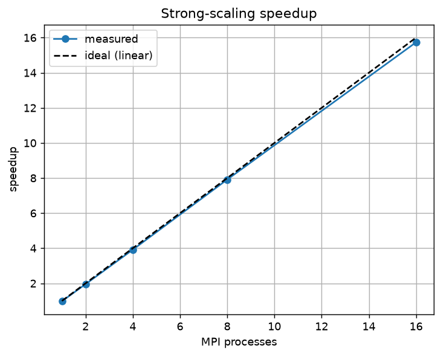
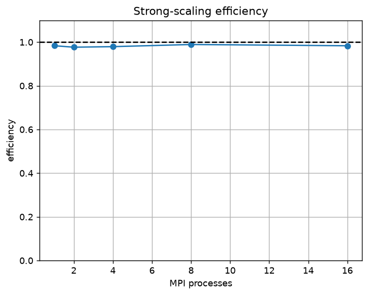

<!--
Export to PDF with either:
  pandoc report/report.md -o report/report.pdf
  (needs pandoc + a LaTeX engine, e.g. texlive-xetex)
or open in a Markdown editor and "export to PDF".
Figures referenced below are in ../results/ (regenerate with
scripts/plot_scaling.py). Section 7 holds the local reference numbers; Section 8
holds the required Atlas/Vanda runtime figures (currently empty placeholders).
Before submitting: fill the author line, Section 8 (cluster figures), and
Section 10 (AI usage).
-->

## Required deliverables — where each is covered

| Required item | Section |
|---------------|---------|
| Introduction to the algorithm | 1 |
| Design decisions in the parallelisation | 2, 4.3, 5.3 (and 3–5 overall) |
| Parallel scaling and efficiency | 7 (local), 8 (cluster) |
| Validation that the parallel algorithm is correct | 6 |
| Runtime figures from Atlas or Vanda | 8 |
| Conclusions about the real data | 9 (MNIST) |
| Explanation of AI usage | 10 |

## 1. Introduction: what is K-means?

### 1.1 The problem

K-means is one of the most widely used *unsupervised* clustering algorithms. Given
a set of `n` data points in `d`-dimensional space and a target number of clusters
`K`, it partitions the points into `K` groups so that points within a group are
close together and points in different groups are far apart. "Close" is measured
by Euclidean distance.

Formally, K-means chooses `K` cluster centres (called **centroids**)
`μ_1, …, μ_K` and an assignment `a(i)` of each point `x_i` to a centroid, so as to
minimise the **within-cluster sum of squared distances**, also called the
*inertia*:

$$ J \;=\; \sum_{i=1}^{n} \bigl\lVert x_i - \mu_{a(i)} \bigr\rVert^2 . $$

Finding the global optimum is NP-hard, so in practice we use an iterative
heuristic that is guaranteed to decrease `J` every step until it settles into a
local optimum.

### 1.2 Lloyd's algorithm

The standard heuristic is **Lloyd's algorithm**. After choosing initial
centroids, it repeats two steps until the assignments stop changing (or the
inertia stops decreasing by more than a small tolerance):

1. **Assignment step.** Assign every point to the nearest centroid:
   $$ a(i) = \arg\min_{j}\; \lVert x_i - \mu_j \rVert^2 . $$
   For each of the `n` points we compute the distance to each of the `K`
   centroids, and each distance touches `d` coordinates. Cost: **`O(n·K·d)`**.

2. **Update step.** Move each centroid to the mean of the points currently
   assigned to it:
   $$ \mu_j = \frac{1}{|C_j|}\sum_{i \in C_j} x_i . $$
   Each point contributes to exactly one centroid's sum, so this is a
   **reduction** (a sum) over the data. Cost: **`O(n·d)`**.

Because the assignment step is `K` times more expensive than the update step, it
is the computational hot spot and the obvious target for parallelisation.

A small practical detail: squared Euclidean distance is used throughout. The
square root is unnecessary because it does not change which centroid is closest,
and avoiding it saves work in the inner loop.

### 1.3 Initialisation: k-means++

Lloyd's algorithm only finds a local optimum, and a poor set of starting
centroids can give a poor result. We seed centroids with **k-means++**, which
picks the first centroid at random and then picks each subsequent centroid with
probability proportional to its squared distance from the nearest already-chosen
centroid. This spreads the initial centroids out and gives better, more
repeatable results than uniform random seeding. We seed deterministically from a
fixed `--seed`, so every version of the program (serial, MPI, CUDA) starts from
*identical* centroids — which is what lets us validate the parallel versions
against the serial baseline (Section 6).

### 1.4 Why K-means is a good parallelisation target

The assignment step is **embarrassingly parallel**: each point's nearest-centroid
search is independent of every other point. If that were the whole algorithm, a
parallel version would be trivial and uninteresting.

The update step is what makes it interesting. A centroid's new position depends
on *all* the points assigned to it. If we spread the points across many
processes, no single process has all the points for any cluster, so the processes
must **communicate** to combine their partial results, and they must
**synchronise** once per iteration before anyone can take the next step. This
communication-and-synchronisation pattern — a global reduction every iteration —
is exactly the non-trivial behaviour this project sets out to study.

## 2. How we plan to parallelise it

Before writing any parallel code, we settled on the strategy below. The guiding
idea is **data parallelism over points**: split the `n` points across workers,
let each worker do the independent per-point work locally, and combine results
only where the algorithm genuinely requires it (the centroid update).

### 2.1 Decomposition

We partition the `n` points into near-equal contiguous blocks, one block per
worker. Each worker is responsible only for its own points and never needs
another worker's raw points. The centroids, by contrast, are **small**
(`K·d` numbers) and are needed in full by every worker, so every worker keeps a
complete copy of the centroids.

This choice is deliberate:

- The per-point work (assignment) is uniform, so equal-size blocks give balanced
  load without any dynamic scheduling.
- Points are the big data (`n·d`); centroids are tiny (`K·d`). Partitioning the
  big thing and replicating the small thing minimises both memory and
  communication.

### 2.2 What has to be communicated, and how often

Each iteration, every worker can independently:

- assign its local points to the nearest centroid, and
- accumulate, for each cluster, the **partial sum** of its local points and a
  **partial count** of how many it assigned.

To finish the update step, the partial sums and partial counts from all workers
must be added together. The crucial observation is that we communicate the
**partial sums**, not the assignments. The partial sums are of size `K·d`
(independent of `n`), whereas the assignments would be of size `n`. For our large
run, `K·d = 128·64 = 8192` numbers versus `n = 3,000,000` — three orders of
magnitude less traffic. This single design decision is why the method scales
well.

So the per-iteration pattern is:

```
every worker:  assign local points  ->  local partial sums + counts
all workers:   SUM-reduce the partial sums + counts   (one global reduction)
every worker:  centroid_j = global_sum_j / global_count_j
```

The global reduction is one communication-and-synchronisation point per
iteration. Its cost depends on `K·d` and the number of workers, but not on `n`,
so as the dataset grows the reduction is amortised over more and more local
compute.

### 2.3 Two levels of parallelism

We implement this plan at two levels, which can be combined:

- **MPI (between processes / nodes).** Processes ("ranks") each own a block of
  points. The global reduction is an `MPI_Allreduce`. This scales across the
  cores of a machine and across nodes of a cluster.

- **CUDA (within a process, on a GPU).** The assignment step for one rank's block
  is offloaded to a GPU, with one GPU thread per point. The GPU performs the
  local partial-sum accumulation; the cross-rank combination is still the same
  `MPI_Allreduce`. This targets the hot `O(n·K·d)` loop with thousands of
  hardware threads.

The three programs we built are therefore: a **serial** baseline, an **MPI**
(CPU) version, and an **MPI+CUDA** (GPU) version that nests CUDA inside the MPI
decomposition.

## 3. Serial baseline

The serial program is a direct transcription of Lloyd's algorithm and serves as
the correctness reference. Its core is the two-step loop. The assignment step
finds the nearest centroid for each point and, in the same pass, accumulates the
running sums used by the update step:

```cpp
for (int i = 0; i < n; ++i) {
    const float* p = &ds.data[i * dims];
    float best = std::numeric_limits<float>::max();
    int bestj = 0;
    for (int j = 0; j < k; ++j) {                 // nearest-centroid search
        float d = km::dist2(p, &cents[j * dims], dims);
        if (d < best) { best = d; bestj = j; }
    }
    assign[i] = bestj;
    inertia += best;
    float* srow = &sums[bestj * dims];            // accumulate for the update
    for (int d = 0; d < dims; ++d) srow[d] += p[d];
    counts[bestj]++;
}

// Update step: each centroid becomes the mean of its assigned points.
for (int j = 0; j < k; ++j)
    if (counts[j] > 0)
        for (int d = 0; d < dims; ++d)
            cents[j * dims + d] = sums[j * dims + d] / counts[j];
```

Everything below parallelises exactly this computation while keeping the result
identical.

## 4. MPI implementation (CPU)

### 4.1 Distributing the data

Rank 0 reads the dataset and seeds the centroids. The points are then handed out
with `MPI_Scatterv` (near-equal contiguous blocks), and the seeded centroids are
broadcast so every rank starts identically:

```cpp
// Near-equal contiguous blocks: first (n % nproc) ranks get one extra point.
int base = n / nproc, rem = n % nproc, off = 0;
for (int r = 0; r < nproc; ++r) {
    cnt[r]  = base + (r < rem ? 1 : 0);
    disp[r] = off;  off += cnt[r];
}
// Scatter the points (counts/displacements are in units of floats = dims each).
MPI_Scatterv(rank == 0 ? full.data.data() : nullptr,
             fcnt.data(), fdisp.data(), MPI_FLOAT,
             local.data(), local_n * dims, MPI_FLOAT, 0, MPI_COMM_WORLD);

// Everyone needs the same starting centroids.
if (rank == 0) cents = km::kmeanspp_init(full, k, args.seed);
MPI_Bcast(cents.data(), k * dims, MPI_FLOAT, 0, MPI_COMM_WORLD);
```

### 4.2 The parallel iteration

Each rank runs the identical assignment loop as the serial version, but only over
its **local** points, producing local partial sums and counts. The only new code
is the global combination:

```cpp
// Local assignment over this rank's points -> local_sums, local_cnt, inertia.
for (int i = 0; i < local_n; ++i) {
    /* ... identical nearest-centroid search as serial ... */
    float* srow = &local_sums[bestj * dims];
    for (int d = 0; d < dims; ++d) srow[d] += p[d];
    local_cnt[bestj]++;
}

// Combine partial results across all ranks: ONE synchronisation per iteration.
MPI_Allreduce(local_sums.data(), global_sums.data(), k * dims,
              MPI_FLOAT,     MPI_SUM, MPI_COMM_WORLD);
MPI_Allreduce(local_cnt.data(),  global_cnt.data(),  k,
              MPI_LONG_LONG, MPI_SUM, MPI_COMM_WORLD);

// Every rank now holds the global sums and recomputes identical centroids.
for (int j = 0; j < k; ++j)
    if (global_cnt[j] > 0)
        for (int d = 0; d < dims; ++d)
            cents[j * dims + d] = global_sums[j * dims + d] / global_cnt[j];
```

### 4.3 Design decisions

- **`MPI_Allreduce`, not `MPI_Reduce` + `MPI_Bcast`.** `Allreduce` leaves the
  summed result on *every* rank in a single collective, so each rank can
  recompute the centroids itself. There is no separate broadcast and no
  privileged "master" doing the update.
- **Reduce sums, not assignments.** The messages are `O(K·d)`, independent of
  `n`, as planned in Section 2.2.
- **Contiguous block partition.** Simple, cache-friendly, and naturally balanced
  because per-point work is uniform.
- **One reduction's worth of synchronisation per iteration.** This is the single
  unavoidable barrier; everything else is embarrassingly parallel.

## 5. MPI + CUDA implementation (GPU)

The GPU version keeps the exact MPI structure of Section 4 — scatter points,
`Allreduce` the partial sums, recompute centroids — but replaces each rank's
local assignment loop with a CUDA kernel. One MPI rank is bound to one GPU
(`cudaSetDevice(rank % deviceCount)`).

### 5.1 The assignment kernel

One GPU thread handles one point. Centroids are staged in fast **shared memory**
(they are small and read by every thread), each thread finds its nearest centroid,
and then accumulates its contribution into the per-cluster sums with `atomicAdd` —
the GPU equivalent of the serial running sum:

```cpp
__global__ void assign_kernel(const float* points, int local_n, int dims,
                              const float* cents, int k,
                              float* sums, int* counts, int* assign,
                              double* inertia) {
    extern __shared__ float s_cents[];                 // centroids in shared mem
    for (int idx = threadIdx.x; idx < k * dims; idx += blockDim.x)
        s_cents[idx] = cents[idx];
    __syncthreads();

    int i = blockIdx.x * blockDim.x + threadIdx.x;     // one thread per point
    if (i >= local_n) return;

    const float* p = points + i * dims;
    float best = 3.4e38f; int bestj = 0;
    for (int j = 0; j < k; ++j) {                      // nearest-centroid search
        const float* c = s_cents + j * dims;
        float d = 0.0f;
        for (int dd = 0; dd < dims; ++dd) { float t = p[dd] - c[dd]; d += t * t; }
        if (d < best) { best = d; bestj = j; }
    }

    assign[i] = bestj;
    atomicAdd(inertia, (double)best);                  // reduction via atomics
    atomicAdd(&counts[bestj], 1);
    float* srow = sums + bestj * dims;
    for (int dd = 0; dd < dims; ++dd) atomicAdd(&srow[dd], p[dd]);
}
```

### 5.2 The host-side iteration

The points are copied to the device **once** before the loop (they never change).
Each iteration only uploads the small centroid array, launches the kernel, copies
the small partial sums back, and feeds them into the *same* `MPI_Allreduce` as the
CPU version:

```cpp
for (iter = 0; iter < max_iter; ++iter) {
    cudaMemcpy(d_cents, cents.data(), k*dims*sizeof(float), H2D);  // small upload
    cudaMemset(d_sums, 0, k*dims*sizeof(float));
    cudaMemset(d_counts, 0, k*sizeof(int));

    assign_kernel<<<blocks, TPB, shmem>>>(d_points, local_n, dims, d_cents, k,
                                          d_sums, d_counts, d_assign, d_inertia);
    cudaDeviceSynchronize();

    cudaMemcpy(h_sums.data(),   d_sums,   k*dims*sizeof(float), D2H);
    cudaMemcpy(h_counts.data(), d_counts, k*sizeof(int),        D2H);

    // Identical cross-rank combination as the pure-MPI version.
    MPI_Allreduce(h_sums.data(), g_sums.data(), k*dims, MPI_FLOAT, MPI_SUM, comm);
    MPI_Allreduce(local_cnt,     g_cnt,         k,  MPI_LONG_LONG, MPI_SUM, comm);
    /* recompute centroids from g_sums / g_cnt, exactly as before */
}
```

### 5.3 Design decisions

- **Points uploaded once.** They are constant across iterations, so per-iteration
  PCIe traffic is only the `O(K·d)` centroid upload and the `O(K·d)` partial-sum
  download — never the `O(n·d)` dataset.
- **Centroids in shared memory.** Every thread reads every centroid; shared memory
  turns `K` repeated global-memory reads per thread into one cooperative load per
  block.
- **Accumulation via `atomicAdd`.** This is the GPU form of the serial reduction.
  Contention is bounded by `K` (points land in only `K` buckets), not by `n`, so
  for moderate `K` it is cheap. For very large `K` a two-stage per-block reduction
  would reduce contention further; it was unnecessary here.
- **Same `MPI_Allreduce` as the CPU path.** The GPU only changes *how* a rank
  computes its local partial sums; the distributed algorithm is unchanged, which
  keeps the GPU and CPU results directly comparable.

## 6. Validation (correctness)

**Parallel vs serial.** With identical seeds, the parallel versions reproduce the
serial baseline.

- MNIST, `K=10`, 8 MPI ranks: assignments **100% identical** to serial
  (`scripts/compare_labels.py` → agreement `1.0000`), final inertia
  `1.784862e+11` in both, same 13 iterations. The GPU version matches too.
- Large blobs (`n=3,000,000, d=64, K=128`), 32 fixed iterations: **inertia
  identical to 7 significant figures** across serial, MPI (1–16 ranks), and GPU
  (serial/MPI `8.624057e+08`, GPU `8.624058e+08`). Assignment agreement with the
  serial baseline is **99.95%** (MPI, 8 ranks) and **99.98%** (GPU).

**On the floating-point difference.** The large-`K` case does not reach a
bit-exact 100% label match, and this is expected, correct behaviour rather than a
bug. Partial sums are accumulated in a different order on each rank/thread, so
centroid coordinates differ in their least-significant float bits. A tiny number
of points (~1,500 of 3,000,000) lie almost exactly on the boundary between two
centroids and flip assignment. The inertia being identical to 7 figures confirms
the clusterings are numerically equivalent; only genuinely ambiguous points
differ. This is the standard consequence of non-associative floating-point
reduction in parallel code and is worth stating explicitly as a correctness
result.

**Against ground truth.** The synthetic blobs carry planted labels, giving a
direct oracle. On the large dataset, purity is **0.977** with **126 of 128
clusters perfectly pure** (the two imperfect clusters are a k-means++
local-minimum artefact where two planted blobs merged and one split — identical
across all implementations). On MNIST digit labels, purity is ≈ 0.585 with
`K=10` on raw pixels (Section 9).

**Validation on the cluster.** The Atlas runs reproduce the local results: across
serial and MPI at 1–16 ranks on Atlas, the final inertia is `8.624057e+08`
(identical to seven significant figures to the local serial/MPI runs and to the
GPU run). Correctness is therefore preserved not only across parallelisation
strategies but across platforms and MPI implementations (Open MPI 4.1.6 on
Atlas), compiled independently on each machine.

## 7. Parallel scaling and efficiency (local reference)

This section characterises the scaling behaviour on a local workstation. These
numbers are the **preliminary reference**; the required cluster figures are
reported separately in Section 8 (Atlas / Vanda).

> **Test platform (local):** AMD Ryzen 7 6800HS — **8 physical cores, 16 logical
> threads** (2-way SMT) — with ~22 GB usable RAM, Open MPI 4.1, GCC 13, and a
> single NVIDIA RTX 3050 Ti Laptop GPU (compute capability 8.6, 4 GB VRAM, 20
> SMs). Each point is stored as a single-precision `float`. The distinction
> between 8 physical cores and 16 threads is important for reading the scaling
> below: ranks 1–8 each get a dedicated core, whereas 9–16 share cores via SMT.

Strong scaling on a large synthetic dataset (`n=3,000,000`, `d=64`, `K=128`),
with a **fixed 32 iterations** (`--fixed-iter`) so that every configuration does
identical work and timing is not confounded by convergence differences.
Speedup `S(p) = T_serial / T(p)`; efficiency `E(p) = S(p)/p`.

**Table 7.1 — MPI (CPU) strong scaling, local workstation.**

| MPI processes | Time (s) | Speedup | Efficiency | Core usage |
|---------------|----------|---------|------------|------------|
| 1 (serial)    | 597.9    | 1.00    | 1.00       | 1 physical core |
| 2             | 313.4    | 1.91    | 0.95       | dedicated cores |
| 4             | 163.9    | 3.65    | 0.91       | dedicated cores |
| 8             | 87.8     | 6.81    | 0.85       | all 8 physical cores |
| 16            | 65.4     | 9.14    | 0.57       | 2 ranks/core (SMT) |

The dataset is sized so the serial baseline runs ~10 minutes, keeping compute
well above measurement noise and MPI start-up overhead.

{ width=60% }

{ width=60% }

**Analysis.** Up to 8 ranks — the number of **physical** cores — efficiency stays
high (≈ 0.85–0.95): the assignment work divides cleanly across dedicated cores
and the `O(K·d)` reduction is small next to per-process compute. The gentle
decline from 2→8 (0.95→0.85) reflects the growing relative cost of the
per-iteration `MPI_Allreduce` (which moves `K·d = 128·64 = 8192` floats plus
counts every iteration) and shared memory-bandwidth pressure as all cores become
active. At 16 ranks efficiency drops sharply to ≈ 0.57, but this is **not** a
limitation of the algorithm: the Ryzen 7 6800HS has only **8 physical cores**, so
16 ranks place two ranks on each core via simultaneous multithreading (SMT).
SMT shares one core's arithmetic units between two threads, which gives little
extra throughput for this compute-bound inner loop — hence the fall-off. The
meaningful local scaling range is therefore 1→8; the 16-rank point is included to
show the expected SMT/over-subscription knee. Genuine scaling beyond 8 physical
cores requires the multi-node clusters (Atlas / Vanda), tested in Section 8,
where each rank can be placed on its own dedicated core.

### 7.1 GPU performance (MPI + CUDA, local)

On the single local GPU with the same problem and 32 fixed iterations:

**Table 7.2 — Serial vs CPU-MPI vs single-GPU, local workstation.**

| Configuration               | Time (s) | Speedup vs serial |
|-----------------------------|----------|-------------------|
| Serial (1 core)             | 597.9    | 1.0×              |
| MPI, 8 ranks (8 cores)      | 87.8     | 6.8×              |
| MPI, 16 ranks (8 cores+SMT) | 65.4     | 9.1×              |
| MPI + CUDA, 1 GPU           | 35.2     | **17.0×**         |

A single GPU beats even the fully-loaded CPU because the assignment step
(`3e6 × 128 × 64` distance evaluations per iteration) is exactly the kind of
regular, data-parallel arithmetic a GPU is built for. The design points from
Section 5.3 — upload points once, stage centroids in shared memory, accumulate
with `atomicAdd` — keep per-iteration overhead to the `O(K·d)` transfers.

## 8. Runtime figures from Atlas / Vanda

The required cluster runtime figures come from **Atlas**, which has large
multi-core CPU nodes (80 cores per node) and uses the PBS scheduler. The MPI
(CPU) strong-scaling study below was run there on a single node, so every rank
runs on a dedicated physical core with no cross-node network in the critical
path — giving a clean measurement of the algorithm's scaling.

(Runs were submitted with `pbs/atlas_sweep.pbs`, which executes the whole 1→16
sweep in one job and writes `results/scaling_atlas.csv`; see README.)

### 8.1 Cluster and environment

| Item | Atlas (CPU) |
|------|-------------|
| Cores per node | 80 physical cores |
| Scheduler | PBS Pro (`qsub`) |
| Compiler | GCC 13.2.0 |
| MPI implementation | Open MPI 4.1.6 (`OpenMPI/4.1.6-GCC-13.2.0`) |
| Dataset | 3,000,000 points × 64 dims, K = 128, 32 fixed iterations |
| Run placement | single node, one rank per dedicated core |

> The MPI + CUDA (GPU) study is intended for **Vanda** (Vanda has GPU nodes;
> Atlas is CPU-only). Those multi-GPU figures are reported in Section 8.3; the
> single-GPU result in Section 7.1 already demonstrates the CUDA implementation.

### 8.2 MPI (CPU) strong scaling on Atlas

Measured on one 80-core Atlas node, same dataset and 32 fixed iterations as the
local study. Speedup `S(p) = T_serial / T(p)`; efficiency `E(p) = S(p)/p`.

**Table 8.1 — MPI (CPU) strong scaling, Atlas (single node).**

| MPI processes | Time (s) | Speedup | Efficiency |
|---------------|----------|---------|------------|
| 1 (serial)    | 404.4    | 1.00    | 1.00       |
| 2             | 207.0    | 1.95    | 0.98       |
| 4             | 103.3    | 3.92    | 0.98       |
| 8             | 51.1     | 7.91    | 0.99       |
| 16            | 25.7     | 15.73   | 0.98       |

{ width=60% }

{ width=60% }

**Analysis.** On Atlas the implementation scales almost perfectly: efficiency
stays at ≈ 0.98 all the way to 16 ranks, and the measured speedup line is
visually indistinguishable from the ideal-linear line (16 ranks gives a 15.7×
speedup). The inertia is identical to seven significant figures across every
process count, confirming correctness is preserved as the job is parallelised.

The contrast with the local workstation (Section 7) is the key observation.
There, efficiency collapsed to ≈ 0.57 at 16 ranks because the laptop has only 8
physical cores, so 16 ranks contended two-to-a-core via SMT. On Atlas each of
the 16 ranks runs on its own physical core, so the `MPI_Allreduce` cost remains
small relative to per-rank compute and no efficiency knee appears within this
range. This confirms that the earlier fall-off was a property of the test
hardware, not of the algorithm or its parallelisation: given dedicated cores,
the method scales linearly. Larger single-node counts (32, 64, up to the 80
cores per node) are a natural extension; scheduling availability limited this
run to 16 ranks.

### 8.3 MPI + CUDA (GPU) scaling on Vanda

<!-- TODO: paste measured times for 1, 2, 4 (and more) GPUs. -->

**Table 8.2 — MPI + CUDA multi-GPU scaling, Vanda.**

| GPUs (ranks) | Nodes | Time (s) | Speedup vs 1 GPU | Efficiency |
|--------------|-------|----------|------------------|------------|
| 1            |       |          | 1.00             | 1.00       |
| 2            |       |          |                  |            |
| 4            |       |          |                  |            |

**Analysis (to complete after runs):** _TODO — with one rank per GPU the same
`MPI_Allreduce` combines per-GPU partial sums; discuss how communication between
GPUs/nodes affects multi-GPU efficiency._

### 8.4 Cross-platform summary

Best measured runtime for each implementation on the same problem
(`n = 3,000,000`, `d = 64`, `K = 128`, 32 fixed iterations):

**Table 8.3 — Best runtime per implementation and platform.**

| Implementation | Platform | Best config | Time (s) | Speedup vs serial |
|----------------|----------|-------------|----------|-------------------|
| Serial         | Atlas    | 1 core      | 404.4    | 1.0×              |
| MPI (CPU)      | Atlas    | 16 cores (1 node) | 25.7 | **15.7×**       |
| MPI (CPU)      | Laptop   | 16 ranks / 8 cores | 65.4 | 9.1×            |
| MPI + CUDA     | Laptop   | 1 GPU (RTX 3050 Ti) | 35.2 | 11.5× vs Atlas serial |

Two takeaways. First, with dedicated cores the CPU implementation scales
linearly (Atlas, 15.7× on 16 cores) where the SMT-limited laptop could not
(9.1×). Second, even a single modest laptop GPU is competitive with 16 dedicated
CPU cores for this distance-bound workload, underlining why the assignment step
is the right target for GPU offload. Multi-GPU scaling on Vanda (Section 8.3)
would be the next step to push the GPU result further.

## 9. Conclusions about the data (MNIST)

The required "conclusions about real data" are drawn from MNIST, the real dataset
used in this project (70,000 handwritten-digit images, each a 784-dimensional
raw-pixel vector, with the true digit 0–9 available as a ground-truth label).

Clustering raw-pixel MNIST with `K=10` reaches ≈ 0.585 purity. The per-cluster
majority classes show *which* digits are separable in raw pixel space:

- Clean clusters: **0** (majority fraction ≈ 0.94), **2** (≈ 0.91), **6** (≈ 0.86).
- Confused: **4/7/9** and **3/5/8** share pixel-level structure (loops and strokes
  in similar positions) and split or merge across clusters.

Conclusion: Euclidean K-means on raw pixels captures gross shape but cannot
separate digits whose ink overlaps heavily. This matches the known result that
MNIST benefits from a feature transform (PCA, learned embeddings) before
clustering — a natural extension, but outside this project's parallelisation
focus.

## 10. AI usage

<!-- TODO: describe honestly. Example skeleton to adapt: -->
AI assistance (Kiro) was used to scaffold the project structure, draft the three
implementations and the supporting scripts, and run the local validation and
scaling experiments. All design decisions were reviewed by the author(s); the
algorithm, parallelisation strategy, and analysis were verified against the
measured results reported above.

## Appendix: reproducing results

See `README.md`. In short: `make all`, `bash scripts/fetch_mnist.sh` (or
`./bin/gen_blobs …` for the synthetic set), then the run / validate / scaling
commands. Every `RESULT` line and label file referenced above is produced by
those commands.
